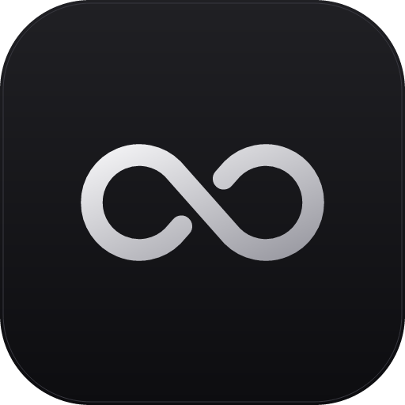
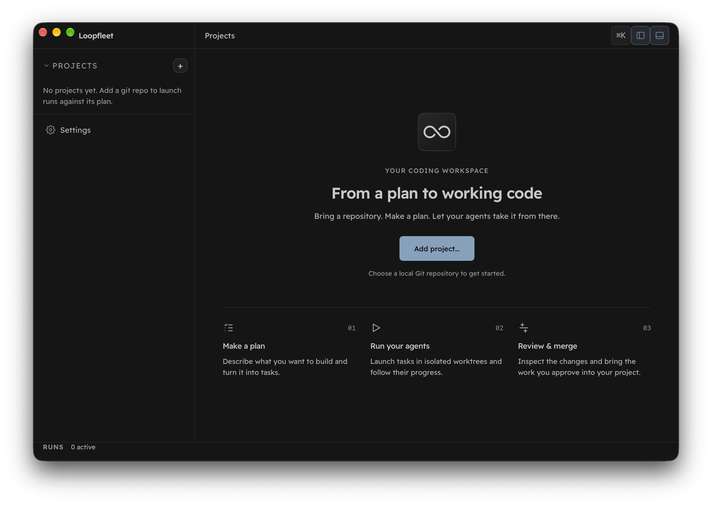

# Loopfleet 

Agent cockpit for spec-and-loop driven development.

  
   <em>Start with a repository, make a plan, run your agents, and review their work.</em>

Write a PRD, break it into tasks, and let coding agents loop on them until every task is accepted. 🚀

Loopfleet is a native macOS app for **scheduled and continuous task execution**. Choose Claude, Codex, pi, or Cursor for each run. Select a model and a schedule. The agents work through your task list until you accept each task.

Context is kept deliberately small per run, so each agent stays focused on its current task instead of drowning in accumulated history. The app keeps the plan, the runs, and the resulting diffs in one place: scan the fleet, review what changed, and accept or reject tasks without losing the thread.

## Live steering

While a run is active, click **Tap** in the run view or press **⌘⇧T**
(**Ctrl+Shift+T**) to open the composer and send guidance. Capable agents
can receive live steering during a pass; other agents queue notes for the
next pass. Notes do not start an extra pass if the run ends. Check the run's
tap status for delivery: sending alone does not confirm delivery. Guidance
can also be queued when live steering is unavailable, or delivery can be
reported as unknown.

Live steering requires **Codex 0.154.0 or later** (app-server) or
**pi 0.80.3 or later** (RPC). Older, unrecognized, or unavailable versions
use notes instead of live steering. Discovery and run handles use the same
version check. Claude Code and Cursor keep their existing transports and
use notes (`can_steer() == false`).

## Download

<!-- download-links:start -->
**Download Loopfleet 0.3.8** —
[Apple Silicon](https://github.com/matija/loopfleet/releases/download/0.3.8/Loopfleet_0.3.8_aarch64.dmg)
· [Intel](https://github.com/matija/loopfleet/releases/download/0.3.8/Loopfleet_0.3.8_x64.dmg)
<!-- download-links:end -->

Signed and notarized `.dmg` builds; the app updates itself from there.
Older builds: [all releases](https://github.com/matija/loopfleet/releases).

> WIP.

## Build from source 🛠️

See [`build/README.md`](build/README.md).
